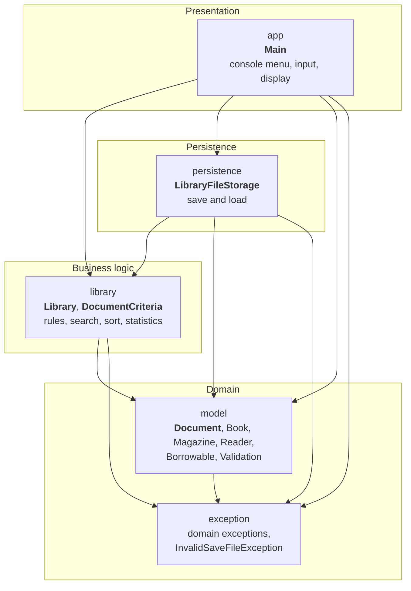
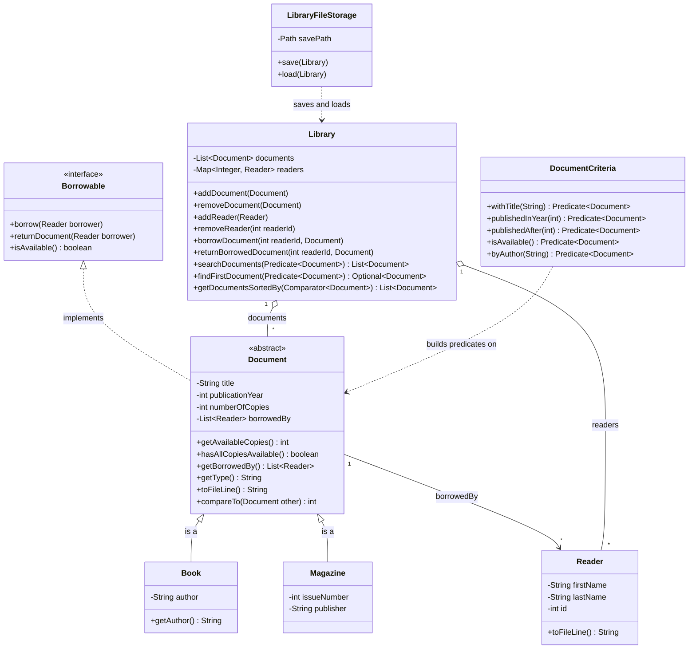
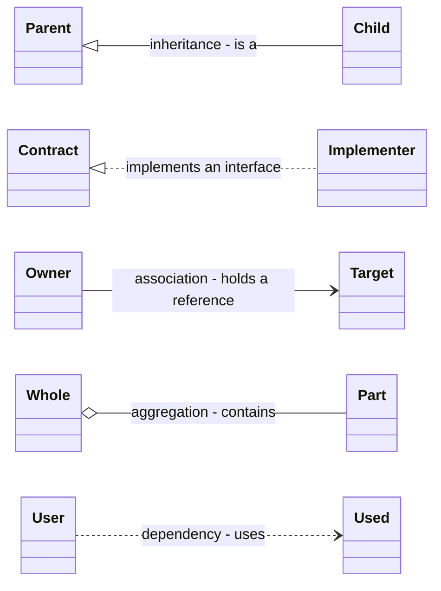
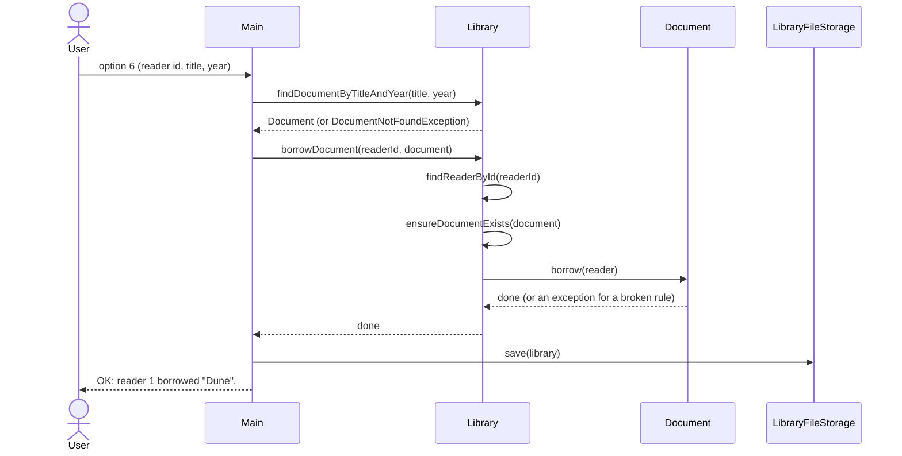
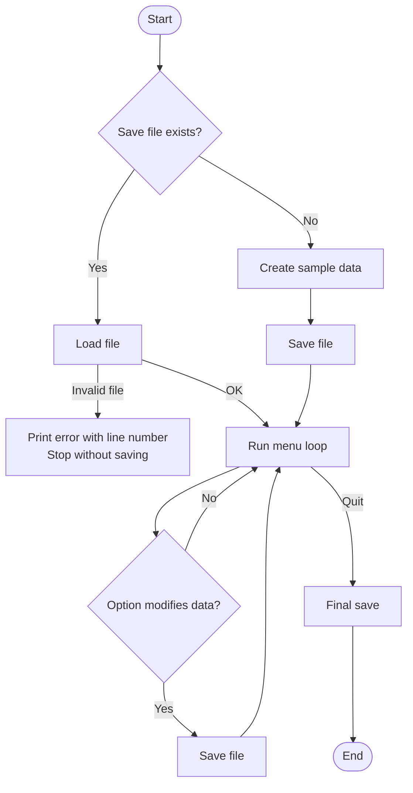
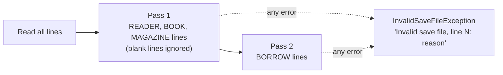

# Architecture

This document describes how `java-library` is organised, how the parts depend on each other, and why the main design choices were made. The diagrams are written in [Mermaid](https://mermaid.js.org/) and are rendered directly by GitHub.

## 1. Layers and packages

The code is split into packages by **responsibility**. Each package has one reason to change, and dependencies only go in one direction.



| Package | Responsibility | Must not |
|---|---|---|
| `app` | Read the keyboard, call the other layers, print results and errors | Contain business rules or file handling |
| `library` | Apply the business rules, search, sort, compute statistics | Know about the console or the file |
| `persistence` | Convert the library to lines of text and back | Apply business rules |
| `model` | Represent documents and readers, validate their own data | Know about the library, the console or the file layer |
| `exception` | Describe the errors of the domain and of the save file | Contain logic |

**Dependency rule:** nothing depends on `app`; `model` and `exception` depend on no other project package (except `model` → `exception`).

## 2. Domain model



### How to read the arrows

Each arrow type has a precise meaning. The text on an arrow is the name of the field, or a short description of the relationship. `"1"` and `"*"` are multiplicities (one, many).



| Arrow | Line | Meaning | Example in this project |
|---|---|---|---|
| `<\|--` | Solid, hollow triangle | **Inheritance**: the child *is a* parent | `Book` is a `Document` |
| `<\|..` | Dashed, hollow triangle | **Implementation** of an interface | `Document` implements `Borrowable` |
| `-->` | Solid, open arrow | **Association**: an object keeps a reference to another; the label is the field name | `Document` holds its `Reader`s in `borrowedBy` |
| `o--` | Solid, hollow diamond | **Aggregation**: the whole contains parts that can exist on their own | `Library` contains documents and readers |
| `..>` | Dashed, open arrow | **Dependency**: a class uses another without keeping it as a field | `LibraryFileStorage` uses `Library` |

`Document` is abstract: a document only exists as a `Book` or a `Magazine`. It carries the shared state and behaviour (title, year, copies, borrowers, availability). `Borrowable` is a contract ("can be borrowed"), independent of the class hierarchy ("is a document"). `Document` also implements `Comparable<Document>` (natural order: title, then publication year).

## 3. Business rules

| Rule | Where it is enforced |
|---|---|
| A reader is unique by id | `Library.addReader` (`ReaderAlreadyExistsException`) |
| A document is unique by type, title, year and its own attributes (`equals`) | `Library.addDocument` (`DocumentAlreadyExistsException`) |
| A reader cannot borrow the same document twice at the same time | `Document.borrow` (`ReaderAlreadyBorrowedDocumentException`) |
| A document cannot be borrowed when no copy is available | `Document.borrow` (`NoCopiesAvailableException`) |
| A document can only be returned by a reader who borrowed it | `Document.returnDocument` (`ReaderHasNotBorrowedDocumentException`) |
| A document cannot be removed while copies are borrowed | `Library.removeDocument` (`DocumentCannotBeRemovedException`) |
| A reader cannot be removed while holding borrowed documents | `Library.removeReader` (`ReaderCannotBeRemovedException`) |
| Borrowing or returning requires an existing reader and an existing document | `Library` (`ReaderNotFoundException`, `DocumentNotFoundException`) |

### Validation (constructors and setters)

| Field | Rule |
|---|---|
| Text fields (title, author, publisher, first name, last name) | Not blank; no `;`, no line break |
| Publication year, number of copies, issue number, reader id | At least 1 |

Invalid values throw an `IllegalArgumentException` that names the field. The `;` and line break restriction exists because of the save file format (see section 6).

## 4. Borrowing a document



The rules live in `Library` and `Document`. `Main` only translates exceptions into messages for the user.

## 5. Application life cycle



The program is saved after each modifying operation, and once more on exit (in a `finally` block, so that it also happens after an unexpected exception). A file that cannot be loaded is **never overwritten**: the program stops before the menu starts.

## 6. Persistence

### Format

```text
READER;firstName;lastName;id
BOOK;title;author;publicationYear;numberOfCopies
MAGAZINE;title;publicationYear;numberOfCopies;issueNumber;publisher
BORROW;title;publicationYear;readerId
```

Each model class knows how to represent itself (`toFileLine()`). `LibraryFileStorage` knows where and how the text is written and read, and how to rebuild the right object from each line type.

### Saving

The file is a **snapshot of the current state**, so each save rewrites it entirely (readers first, then each document followed by its `BORROW` lines). Appending to the file would duplicate readers and documents, and would resurrect removed or returned items.

### Loading, in two passes



Borrows are replayed in a second pass because they refer to readers and documents that must already exist. Every problem (unknown line type, wrong number of fields, unreadable number, value refused by the model, unknown reader or document, impossible borrow) is reported with the **line number** and the original exception as the cause.

## 7. Error handling

| Kind | Type | Raised by | Handled by |
|---|---|---|---|
| Broken business rule | Unchecked domain exceptions | `Library`, `Document` | `Main`, which prints `Error: <message>` and returns to the menu |
| Invalid value | `IllegalArgumentException` | Constructors and setters (`Validation`) | `Main` on user input; `LibraryFileStorage` converts it for file content |
| Invalid or unreadable save file | `InvalidSaveFileException` (checked, extends `IOException`) | `LibraryFileStorage.load` | `Main`: error message, then the program stops without saving |
| Write failure | `IOException` | `LibraryFileStorage.save` | `Main`: error message |

The rule applied everywhere: an exception is **thrown where the problem is detected** and **caught where someone can decide what to do about it**. Domain exceptions are unchecked because they are logic errors. File problems are checked because they come from outside the program, and callers must react to them.

## 8. Testing strategy

| Test class | Scope |
|---|---|
| `LibraryTest` | Rules, exceptions, search, sorting, aggregates, empty library cases |
| `DocumentTest` | Availability, defensive copy, equality, file line format, validation |
| `ReaderTest` | Equality and hash code, file line format, validation |
| `LibraryFileStorageTest` | Round trip, written format, every invalid-file case |

Conventions:
- test names follow `method_expectedResult_condition`;
- each test follows Arrange / Act / Assert, with expected values written explicitly;
- a helper method exists only where it serves several tests (`fillLibrary`, `writeSaveFile`);
- persistence tests use JUnit temporary directories (`@TempDir`), so the real data file is never touched.

The console layer (`Main`) is kept thin and is verified manually: its logic lives in the layers below, which are fully testable.

## 9. Design decisions

| Decision | Reason |
|---|---|
| `List` for documents, `Map<Integer, Reader>` for readers | Documents are mostly listed and searched by criteria; readers are looked up by id on every borrow |
| Fields declared with interface types | The implementation can change without touching the rest of the code |
| One `searchDocuments(Predicate)` instead of one method per criterion | New criteria need no new method in `Library`, and criteria can be combined with `and` / `or` |
| `Comparable` for the natural order, `Comparator` for the others | One default order lives in the class; any other order is chosen by the caller |
| Validation in the model, in one class | An invalid object can never exist, and the rules are written once |
| `Document` is abstract, `Borrowable` is an interface | "What it is" and "what it can do" are separate concerns |
| Defensive copies in getters | Callers cannot empty or reorder internal collections |
| `toFileLine()` in the model, parsing in `LibraryFileStorage` | The model knows how to describe itself; only the persistence layer knows the whole file format |
| Whole-file rewrite, two-pass load | Simple, always consistent with the current state, and borrows can refer to any reader or document in the file |
| Strict loader that never overwrites a file it could not read | A corrupted file must never be silently replaced by partial data |
